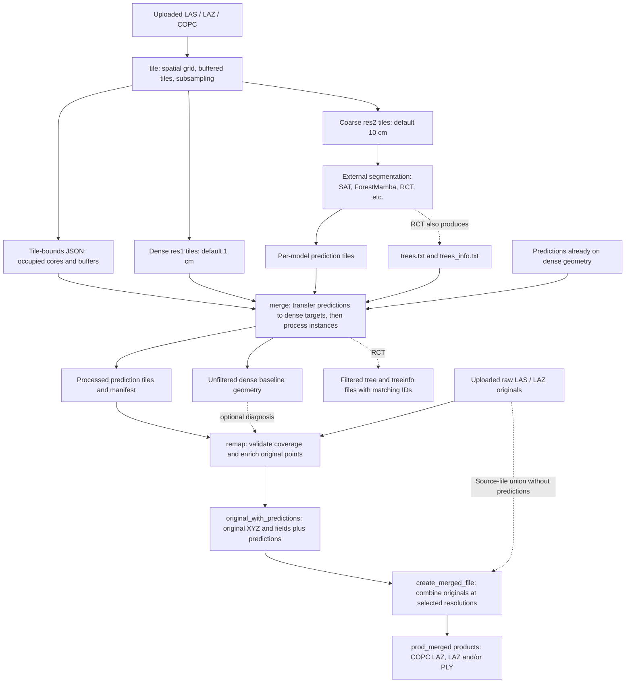
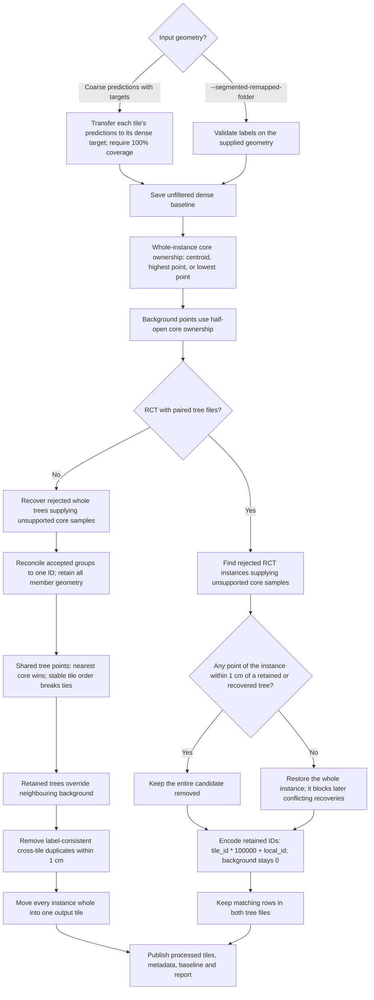

# SmartTile task workflow

The `src/run.py` task routes, with the default resolutions res1 = 1 cm and
res2 = 10 cm. Keep the uploaded originals throughout: they supply the geometry
and metadata of the enriched originals and products.

## How the tasks connect

Galaxy exposes the same four tasks; its **Filter / merge segmented tiles** tool
is `merge` and returns processed tiles and RCT companions. Original enrichment
and products use the separate Remap and Create merged file tools; the CLI merge
can also enrich originals when `--original-laz-input-dir` is given.

`merge --segmented-remapped-folder` accepts predictions that already lie on the
dense geometry and skips the transfer. With `--resolution-1` set to their
spacing (e.g. `0.1`) it also filters coarse tiles from the same tiling run
without targets. This does not create fine points or promise the same
anchor/group decisions as processing fine targets. For RCT, keep both tree
tables beside each prediction tile when entering merge; standalone remap finds
the filtered tables beside the predictions or through the merge manifest's
`rct_tree_sidecars` path.

## Inside merge

Recovery ranks candidates by distinct unsupported core samples, then stable
source-tile order and local ID. For RCT the conflict gate checks the entire
candidate, including buffer tails; background never blocks. RCT processing does
not reconcile trees, reassign their points or deduplicate them. Every decision,
loop and failure path is in [filter-decision-flow.md](filter-decision-flow.md);
the RCT contract and a real conflict example are in
[raycloud-filter-only.md](raycloud-filter-only.md).

## Task inputs and outputs

| Task | Required input | Main output |
| --- | --- | --- |
| `tile` | Source point clouds | `subsampled_res1/` … `subsampled_resN/` (one per `--tile-outputs` entry), `tile_bounds_tindex.json`, job list, tindex, overview |
| `merge` | Prediction collection(s), tile-bounds JSON, optional dense targets; RCT tree tables per tile | Processed tiles, `instance_metadata.csv`, `smarttile_merge.json`, effective `tile_bounds.json`, sibling `*_unfiltered_1cm/`, `remap_first_report.json`; RCT `segmented_filtered/`; optional enriched originals |
| `remap` | Processed prediction collection(s) and uploaded LAS/LAZ originals; baseline optional | One enriched file per original, `instance_mapping.json`, `<folder>_coverage.json` |
| `create_merged_file` | Enriched originals, or source files for a union; optional staged COPC cache and standardization JSON | `merged.<format>` (full) and `prod_merged_<label>.<format>`, in `copc.laz`, `laz` and/or `ply` |

Merge always checks baseline coverage when it enriches originals. Remap checks
it when `--baseline-1cm-folders` is given or the merge manifest's baseline
folder still exists; otherwise it checks final coverage only, which implies
baseline coverage for merged predictions (they lie on the dense geometry).

## Tiles with empty cores

The single read counts the source points inside every planned core (boundaries
inclusive, so shared edge points count in both cores) and discards tiles whose
core holds none; buffer-only points do not qualify. Retained tiles keep their
full buffers, grid column/row identities and core bounds.
`tile_bounds_tindex.json` lists only retained tiles, with skipped cores under
`core_occupancy.skipped_tiles`; the job list, overview and neighbour discovery
use that retained layout. The rule is geometric: a core with only ground points
still qualifies. The single-cloud bypass is unchanged.

## Matching distances and final coverage

| Check | Distance / rule |
| --- | --- |
| Coarse prediction to target tile | Galaxy: √3 × segmented voxel size; CLI `--prediction-transfer-tolerance` default **0.1732 m**. Every target point must match. |
| Cross-tile instance correspondence | **0.05 m**, then mutual-best pairing and `--overlap-threshold`. Independent of the transfer radius. |
| Tree support, RCT recovery conflicts, duplicates | **0.01 m** XYZ. |
| Original point to prediction | Default **√3 × res1** (0.0173 m at 1 cm); `--remap-tolerance` overrides it. |
| Original to unfiltered baseline | **100%** whenever the baseline is checked. |
| Original to final non-RCT predictions | **100%**; missing matches fail publication. |
| Original to final RCT predictions | Nearest positive tree within the radius wins over background; unmatched points get **0** in every RCT field and are reported. |

Coarse-only inputs must keep the sampled coordinates of the same tiling run;
SmartTile does not verify this provenance. Independently shifted or resampled
predictions need common dense targets. `resolution_1_m` in the report records
the processed spacing, even where report or baseline names contain `1cm`.

## Intermediate versus final merged files

- The optional `merged_tiles.laz` from `merge` concatenates processed tiles. It
  is an intermediate, written only for a single non-RCT collection; use
  `--skip-merged-file` for RCT.
- User-facing `prod_merged_*` products come from enriched originals via
  `create_merged_file` (or `--produce-merged-file` on merge/remap). Product
  subsampling keeps real source points. PLY cannot carry LAS CRS/VLR metadata.
- RCT tree/QSM tables remain separate aligned outputs. SmartTile produces no DTM.

## Original-resolution handoff

Spatial and whole-instance tiling share the Galaxy **Output** selections: a voxel
size or **Original resolution**, then LAZ, COPC LAZ or binary PLY. On the CLI use
`--tile-outputs original:laz` for spatial geometry, or
`--instance-tiles PredInstance_SAT,PredInstance_FM --instance-outputs original:copc.laz,0.1:laz`
for whole instances from two segmentations: the first dimension uses
`subsampled_res1/`, `subsampled_res2/`, …; the second
`instance_dim2/subsampled_res1/`, …. Each collection keeps only its own instance
field plus requested attributes. Original resolution keeps duplicate points and
the source coordinate grid; incompatible grids fail. After species annotation,
remap with `--prediction-resolution-original` (Galaxy: **Prediction resolution →
Original resolution**) and `--match-instances`: coordinates match within LAS
encoding precision and every original point must match for all models.

## Implementation entry points

- Task routing: [`src/run.py`](../src/run.py).
- Tiling: [`src/main_tile.py`](../src/main_tile.py) (`plan_tiling`),
  [`src/tile_centroids.py`](../src/tile_centroids.py) (single read),
  [`src/tile_core_occupancy.py`](../src/tile_core_occupancy.py),
  [`src/output_names.py`](../src/output_names.py) (output names).
- Merge, remap and enrichment: [`src/remap_first_pipeline.py`](../src/remap_first_pipeline.py).
- RCT recovery gate: [`src/raycloud_recovery.py`](../src/raycloud_recovery.py);
  orphan selection: [`src/orphan_claims.py`](../src/orphan_claims.py).
- Products: [`src/main_create_merged_file.py`](../src/main_create_merged_file.py).
